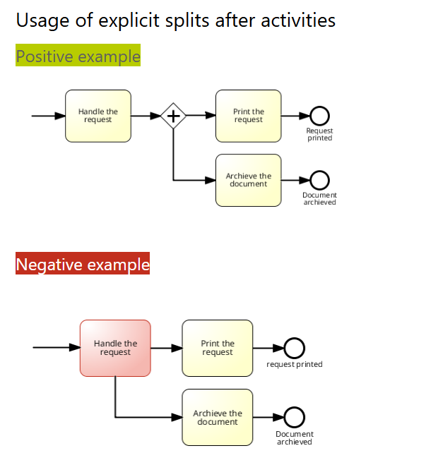
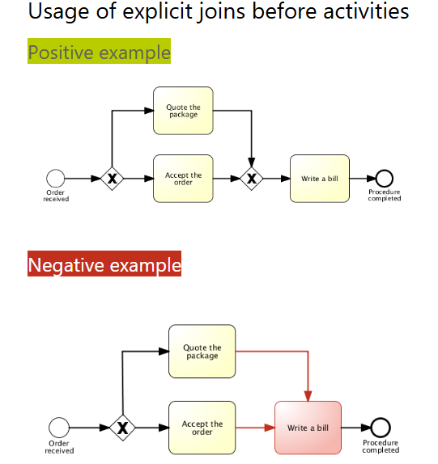
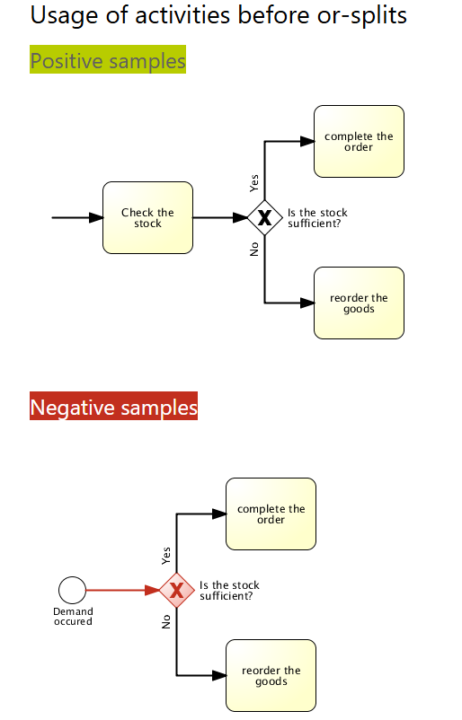
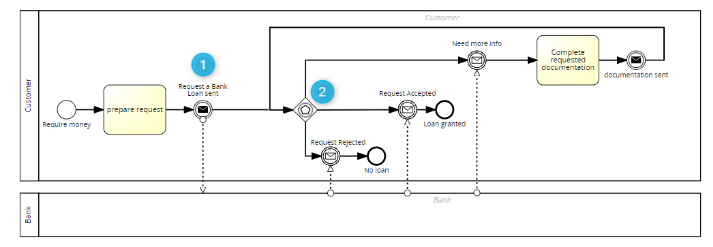
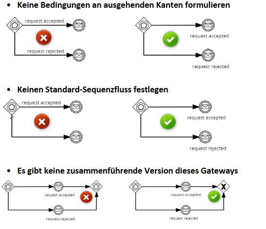
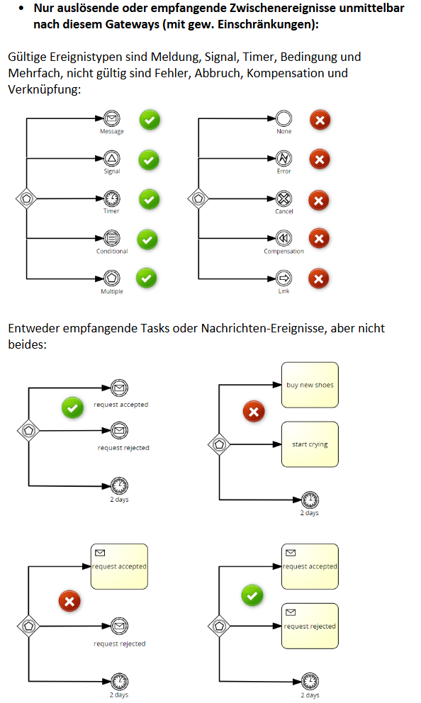
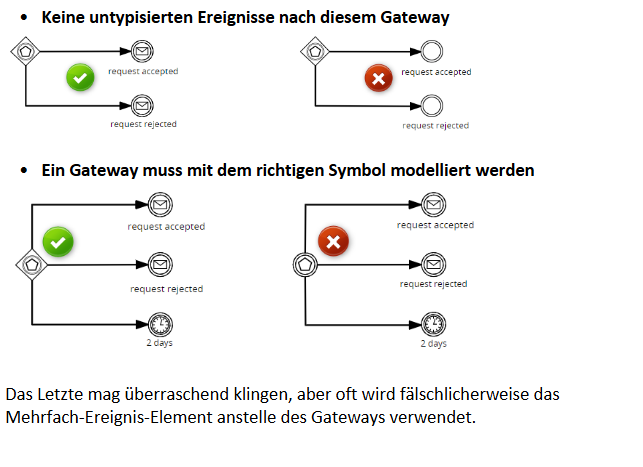

**Was ist BPMN?**
Business Process Model and Notation--> Grafische Notation für die Modellierung von Geschäftsprozessen darstellen, welche durch OMG standartisiert wurde. Damit wird Verständlichkeit, Kommunikation von Prozessen im Ug verbessert.
- Beginnt mit Startaktivität
- Besteht aus mehreren Aktivitäten, durch Rechteckige Symbole dargestellt.
- Zwischen Aktivitäten: Flusskontrollen, durch Pfeile dargestellt-->Abfolge der Aktivitäten darstellen
- Entscheidungs-Gateways als diamantförmiges Symbol.
- Endet mit End-Aktivität

**D.30.I Splitting, Joining and Descision-Making**

Sequenzflüsse soollten nur gespalten werden durch Gateways um Klarheit und Leserlichkeit zu sichern. Eine Aktivität darf nur einen ausgehenden Sequenzfluss haben. Um mehr als ein eingehender Sequenzfluss in ein Element zu führen verwendet man Gateways. So vermeidet man Modellierungsfehler da sonst Multi-Merges oder Deadlocks entstehen.

Joins sollten explizit modelliert werden durch Gateways. Elemente mit Ausnahme von Gateways dürfen nur ein Sequenzfluss haben. Wieder das von oben vermeiden.

Für klaren Prozess Or-Split: vorgehende Aufgabe. Diese Regel prüft, ob vor einem XOR-Gateway eine Aktivität definiert wurde. Um den aktiven Prozessfluss aufzuteilen, muss vorher eine Aktivität ausgeführt worden sein. Um die Regel einzuhalten, musst du vor jedem XOR-Gateway eine Aufgabe modellieren.  
Wird das als Fehler angezeigt, musst du vor dem XOR-Gateway eine Aktivität einfügen. Or-Splits sind: das datenbasierte exklusive Gateway (XOR), das ereignisbasierte Gateway und das inklusive Gateway.

****
**D.40 I: Das Ereignisbasierte Gateway - Anmerkungen**
Spezielle Art des exklusiven Gateways. Wird verwendet wenn man die Entscheidungen von einem anderen Teilnehmer getroffen wird, basierend auf für den Prozess unsichtbare Daten.

An einigen Stellen unserer Prozesse müssen wir auf eine Handlung oder Entscheidung eines externen Teilnehmers warten. Der Prozess trifft diese Entscheidung nicht selbst, kann aber darauf reagieren. Bsp bei Bank bei einem Antrag auf einem Darlehen.

Das was als Nächstes passiert, ist nicht abhängig von unserer Entscheidung. Die Entscheidung wird ausserhalb dieses Prozesses auf Grundlage einiger unbekannter Kriterien getroffen. Deshalb können wir anstelle von nicht das "gewöhnliche" datenbasierte Exklusiv-Gateway verwenden.

Regeln fürs Event-Basierte Gateway:

